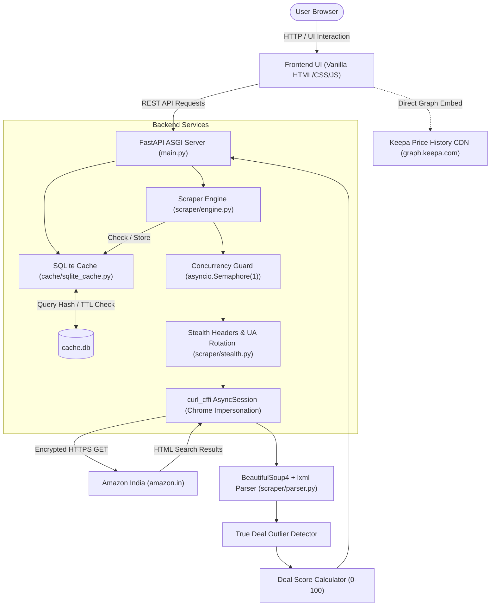

# 🛒 Amazon Deal Finder (`Amzdeals`)

[](https://www.python.org/downloads/)
[](https://fastapi.tiangolo.com)
[](https://github.com/yifeikong/curl_cffi)
[](tests/)
[](LICENSE)

An asynchronous, high-stealth deal discovery and price verification engine for **Amazon India (`amazon.in`)**.

Deal Finder automates the extraction of deeply discounted products using Amazon's native `pct-off` URL query filters and browse-node hierarchies. It filters out sponsored clutter, verifies discounts against statistical baseline outliers, calculates a balanced multi-factor deal quality score, embeds 365-day historical price graphs via Keepa, and delivers the results through a modern glassmorphic web interface.

---

## 🌟 Key Features

- 🔍 **Targeted Discount Range Search**: Query any product keyword (e.g. *Mechanical Keyboard*, *Perfume*, *Air Fryer*) and filter with precise discount windows (e.g., 40%–90%).
- 🏆 **Top Deals by Category (Top 100 & Popularity Sort)**: Automated multi-page scraping across 10 core Amazon.in categories, delivering up to 100 products per category with multi-mode sorting (defaulting to Amazon's native Bestsellers / Popularity ranking, alongside Deal Score, Discount %, and Reviews).
- 🧠 **Statistical Outlier Verification (`is_true_deal`)**: Weeds out artificial MRP markups and baseline discounts by verifying that a product's discount is both $\ge 40\%$ and at least $10\%$ above the category/search median.
- 📊 **Multi-Factor Deal Quality Score (`deal_score`)**: Proprietary 0–100 score ranking products by balancing discount depth (60%), customer review rating (25%), and review volume (15%, capped at 5,000).
- 📈 **Integrated Keepa Price History Graphs**: 1-click embedded 365-day price history charts via a local backend proxy (`GET /api/keepa-graph`) with `referrerpolicy="no-referrer"` fallback, eliminating `localhost` WAF 403 blocks and ad-blocker interruptions.
- 🛡️ **Cryptographic TLS Stealth Engine**: Built on `curl_cffi` with Chrome TLS/JA3/JA4 fingerprint impersonation, serialized `asyncio.Semaphore(1)` concurrency gating, dynamic desktop header rotation, and exponential backoff retry.
- ⚡ **Asynchronous SQLite Cache**: SHA-256 parameterized query caching with a 30-minute TTL to slash redundant Amazon requests by 80%+.
- 🎨 **Glassmorphic Dark UI**: Zero-framework Vanilla JS (ES6+) and modern CSS3 interface featuring skeleton loading states, active tab transitions, and `AbortController` cancellation for rapid navigation without race conditions.

---

## 🏗️ Architecture & Data Flow



---

## 🧮 Algorithmic Foundations

### 1. Statistical True Deal Verification (`is_true_deal`)
E-commerce merchants frequently inflate the Maximum Retail Price (MRP) to display misleading discount percentages. Deal Finder mitigates this by calculating the sample median discount across all returned products in the query:

$$\text{is\_true\_deal} = (\text{discount\_pct} \ge 40\%) \land (\text{discount\_pct} \ge \text{median}(\text{discounts}) + 10\%)$$

A product receives the `✓ Verified Deal` badge only if its discount represents a statistically significant anomaly above the baseline discount of surrounding competitors.

### 2. Multi-Factor Deal Quality Score (`deal_score`)
Products under the **Top Deals** tab are ranked using a composite 0–100 score:

$$\text{Score} = \text{round}\left(0.60 \cdot D + 0.25 \cdot \left(\frac{R}{5.0} \times 100\right) + 0.15 \cdot \left(\frac{\min(V, 5000)}{5000} \times 100\right)\right)$$

Where:
- $D \in [0, 100]$: Raw discount percentage.
- $R \in [0.0, 5.0]$: Customer star rating (normalized to $0-100$).
- $V$: Total verified customer review count (normalized against a 5,000 threshold to prevent legacy products with outdated reviews from dominating newer high-discount deals).

#### Score Tiers:
- **80 – 100 (Emerald)**: Exceptional discount with high ratings and robust social proof.
- **60 – 79 (Amber)**: Solid discount with respectable customer feedback.
- **0 – 59 (Gray)**: High discount but lower rating or limited customer verification.

---

## 🛡️ Anti-Bot & Stealth Engineering

Amazon's anti-scraping defenses actively inspect TLS client handshakes, HTTP/2 frame parameters, and request patterns. Deal Finder incorporates multi-layered defensive countermeasures:

1. **TLS / JA3 Fingerprint Impersonation**: Uses `curl_cffi` (`impersonate="chrome"`) instead of standard Python HTTP clients (`urllib`, `requests`, or vanilla `httpx`). This mirrors modern Google Chrome cipher suites, elliptic curves, ALPN negotiations, and HTTP/2 pseudo-header order.
2. **Persistent Async Session**: Maintains a shared `curl_cffi.requests.AsyncSession` across requests to reuse TLS session tickets and maintain cookie jar continuity.
3. **Concurrency Serialization**: Outbound scraping is guarded by `asyncio.Semaphore(config.MAX_CONCURRENT_SCRAPES)` ($= 1$). Regardless of how many users query the API simultaneously, requests to Amazon are queued sequentially.
4. **Adaptive Throttling**: Random delays between $2.0\text{s}$ and $5.0\text{s}$ are inserted between subsequent page scrapes.
5. **Stealth Header Rotation**: Randomized modern desktop User-Agents across Windows, macOS, and Linux paired with authentic browser `Accept`, `Accept-Language` (`en-IN,en-GB;q=0.9,hi;q=0.6`), `Accept-Encoding`, `Referer`, and `Sec-Fetch-*` headers.
6. **CAPTCHA Interception & Exponential Backoff**: Responses are inspected for CAPTCHA challenges (`"Type the characters you see"`, `"/errors/validateCaptcha"`). Detected challenges trigger exponential backoff retry cycles ($2\text{s}, 4\text{s}, 8\text{s}$).

---

## 🔌 REST API Specification

### 1. Search Deals
Searches Amazon.in products matching a query term within a specific discount range.

- **Endpoint**: `GET /api/search`
- **Parameters**:
  | Parameter | Type | Required | Default | Description |
  |-----------|------|----------|---------|-------------|
  | `query` | string | **Yes** | — | Search term (e.g., `Perfume`, `Mechanical Keyboard`) |
  | `min_discount` | integer | No | `10` | Minimum discount percentage (0–99) |
  | `max_discount` | integer | No | `99` | Maximum discount percentage (1–100) |
  | `page` | integer | No | `1` | Page number for pagination (1–100) |

- **Sample Response**:
  ```json
  {
    "query": "Perfume",
    "page": 1,
    "total_results": 24,
    "cached": false,
    "products": [
      {
        "asin": "B0DNTCMFRG",
        "title": "Park Avenue Eau De Parfum, 100ml",
        "current_price": 239.0,
        "original_price": 999.0,
        "discount_pct": 76,
        "rating": 4.2,
        "review_count": 1543,
        "image_url": "https://m.media-amazon.com/images/I/71xyz.jpg",
        "product_url": "https://www.amazon.in/dp/B0DNTCMFRG",
        "is_prime": true,
        "coupon": "Save 5% with coupon",
        "is_true_deal": true
      }
    ]
  }
  ```

---

### 2. Top Deals by Category
Fetches, deduplicates, and ranks deals for a specific Amazon browse-node across 5 scraped pages, returning up to 100 products.

- **Endpoint**: `GET /api/top-deals`
- **Parameters**:
  | Parameter | Type | Required | Default | Description |
  |-----------|------|----------|---------|-------------|
  | `category` | string | **Yes** | — | Amazon browse-node ID (e.g., `976419031`) |
  | `min_discount` | integer | No | `40` | Minimum discount percentage (0–99) |
  | `max_discount` | integer | No | `90` | Maximum discount percentage (1–100) |
  | `sort_by` | string | No | `popularity` | Sort order: `popularity` (or `bestsellers`), `deal_score`, `discount`, `reviews` |

- **Sample Response**:
  ```json
  {
    "category": "Electronics",
    "node": "976419031",
    "total_results": 100,
    "cached": true,
    "products": [
      {
        "asin": "B08N5WRWNW",
        "title": "Wireless Active Noise Cancelling Headphones",
        "current_price": 1499.0,
        "original_price": 5999.0,
        "discount_pct": 75,
        "rating": 4.4,
        "review_count": 3820,
        "image_url": "https://m.media-amazon.com/images/I/61abc.jpg",
        "product_url": "https://www.amazon.in/dp/B08N5WRWNW",
        "is_prime": true,
        "coupon": null,
        "is_true_deal": true,
        "deal_score": 83,
        "badge": "Best Seller"
      }
    ]
  }
  ```

---

### 3. Browse Categories
Lists all supported browse nodes for curated top deals.

- **Endpoint**: `GET /api/categories`
- **Sample Response**:
  ```json
  [
    {"name": "Electronics", "node": "976419031"},
    {"name": "Fashion", "node": "1571271031"},
    {"name": "Beauty", "node": "1355016031"},
    {"name": "Home & Kitchen", "node": "976442031"},
    {"name": "Books", "node": "976389031"},
    {"name": "Sports", "node": "1984443031"},
    {"name": "Toys", "node": "1350380031"},
    {"name": "Computers", "node": "976392031"},
    {"name": "Mobile Phones", "node": "1389401031"},
    {"name": "Grocery", "node": "2454178031"}
  ]
  ```

---

### 4. Keepa Price History Graph Proxy
Proxies Keepa's 365-day price trend PNG directly with server-side Amazon referer headers, bypassing Cloudflare WAF `localhost` blocks, CORS restrictions, and client-side ad-blockers.

- **Endpoint**: `GET /api/keepa-graph`
- **Parameters**:
  | Parameter | Type | Required | Default | Description |
  |---|---|---|---|---|
  | `asin` | string | **Yes** | — | 10-character Amazon ASIN |
  | `range` | integer | No | `365` | Price history range in days (1–1000) |

- **Response**: Binary image stream (`image/png`) with `Cache-Control: public, max-age=3600`

---

## 💻 Tech Stack & Requirements

| Layer | Technology | Version | Purpose |
|---|---|---|---|
| **Runtime** | Python | `>= 3.12` | High-performance async runtime |
| **API Framework** | FastAPI | `>= 0.115.0` | High-throughput asynchronous REST API |
| **ASGI Server** | Uvicorn | `>= 0.30.0` | Production ASGI web server |
| **Scraping / HTTP** | curl_cffi | `>= 0.7.3` | Chrome TLS/JA3 fingerprint impersonation |
| **HTML Parser** | BeautifulSoup4 + lxml | `>= 4.12.0` / `>= 5.0.0` | Resilient, fast DOM extraction |
| **Caching** | aiosqlite | `>= 0.20.0` | Async embedded SQLite storage |
| **Test Suite** | pytest + pytest-asyncio | `>= 8.0.0` / `>= 0.23.0` | Unit & integration test verification |
| **Frontend** | Vanilla JS / CSS3 / HTML5 | — | Zero-bundle, dark glassmorphic UI |

---

## 🚀 Quickstart & Installation

### 1. Clone Repository
```bash
git clone https://github.com/ubermachine/Amzdeals.git
cd Amzdeals
```

### 2. Create Virtual Environment
```bash
# macOS/Linux
python3 -m venv .venv
source .venv/bin/activate

# Windows (PowerShell)
py -m venv .venv
.venv\Scripts\Activate.ps1
```

### 3. Install Dependencies
```bash
pip install -r requirements.txt
```

### 4. Launch Application
```bash
# Using uvicorn directly:
python -m uvicorn main:app --host 0.0.0.0 --port 8000 --reload

# Or run main.py:
python main.py

# Windows one-click batch launcher:
start_server.bat
```

Open your browser at **`http://localhost:8000`** to access the web application.

---

## ⚙️ Configuration Reference (`config.py`)

All core tuning parameters are centralized in [`config.py`](config.py):

| Variable | Default | Description |
|---|---|---|
| `AMAZON_BASE_URL` | `"https://www.amazon.in/s"` | Base endpoint for search queries |
| `AMAZON_PRODUCT_URL` | `"https://www.amazon.in/dp/{asin}"` | Canonical product link template |
| `CACHE_DB_PATH` | `"cache.db"` | Path to the SQLite cache database file |
| `CACHE_TTL_SECONDS` | `1800` (30 min) | Time-to-live for cached queries |
| `REQUEST_TIMEOUT` | `15` | Max socket timeout in seconds per HTTP call |
| `MAX_RETRIES` | `3` | Maximum retry attempts per request |
| `BACKOFF_BASE` | `2` | Exponential backoff multiplier ($2^1, 2^2, 2^3$) |
| `THROTTLE_MIN` / `MAX` | `2.0` / `5.0` | Random delay bounds between requests (seconds) |
| `MAX_CONCURRENT_SCRAPES` | `1` | Semaphore concurrency limit for Amazon requests |
| `TOP_DEALS_PAGES` | `5` | Number of browse-node pages scraped per category |
| `TOP_DEALS_LIMIT` | `100` | Maximum top-scored products returned per category |

---

## 🧪 Testing & Verification

The test suite validates parsing resiliency, cache expiration, URL builders, scoring logic, and API endpoints using mock fixtures to avoid making live calls during testing.

Run tests:
```bash
pytest tests/
# or
py -m pytest tests/
```

### Test Coverage Highlights:
- `tests/test_cache.py`: Verifies SQLite cache hit, miss, deterministic SHA-256 keys, and TTL auto-expiration.
- `tests/test_parser.py`: Verifies extraction of ASIN, titles, prices, ratings, coupons, and discounts against sample Amazon HTML fixtures.
- `tests/test_deal_score.py`: Tests boundary conditions, null values, 5K review caps, and weighted score calculation.
- `tests/test_true_deal.py`: Validates median outlier calculation under diverse distribution shapes.
- `tests/test_stealth.py`: Validates presence of critical headers (`Accept`, `Referer`, `Sec-Fetch-*`) and User-Agent rotation.
- `tests/test_engine.py`: Tests retry logic, backoff, and CAPTCHA detection.
- `tests/test_top_deals_api.py` & `tests/test_main.py`: Full FastAPI integration tests using `starlette.testclient`.

---

## 📂 Project Structure

```text
DealFinderAmazonPy/
├── main.py                     # FastAPI application factory, lifespan, routes & static mount
├── config.py                   # Centralized configuration (timeouts, cache TTL, browse nodes)
├── requirements.txt            # Python dependencies (curl_cffi, fastapi, bs4, aiosqlite, etc.)
├── start_server.bat            # Windows one-click process manager and launcher script
│
├── scraper/                    # Core scraping and parsing package
│   ├── __init__.py
│   ├── engine.py               # Session pooling, concurrency guard, retry loop & orchestration
│   ├── parser.py               # BeautifulSoup4 DOM parsing, price cleaning & true deal logic
│   └── stealth.py              # Modern browser User-Agent rotation & realistic header generation
│
├── cache/                      # Persistence layer
│   ├── __init__.py
│   └── sqlite_cache.py         # Async SQLite cache with SHA-256 keys and automated TTL eviction
│
├── static/                     # Dark glassmorphic frontend
│   ├── index.html              # Single-page HTML shell with dual-tab layout & skeleton cards
│   ├── style.css               # Glassmorphism styling, responsive CSS grid, animations
│   └── app.js                  # Tab controller, category pills, Keepa chart toggles & XSS guard
│
├── tests/                      # Pytest automated test suite (50 tests)
│   ├── test_cache.py
│   ├── test_category_url.py
│   ├── test_deal_score.py
│   ├── test_engine.py
│   ├── test_keepa_proxy.py
│   ├── test_main.py
│   ├── test_parser.py
│   ├── test_search_category_deals.py
│   ├── test_stealth.py
│   └── test_top_deals_api.py
│
└── docs/                       # Architectural specifications and implementation plans
    └── superpowers/
        ├── specs/
        │   ├── 2025-07-19-deal-finder-design.md
        │   └── 2026-07-19-top-deals-by-category-design.md
        └── plans/
            └── 2026-07-19-top-deals-by-category.md
```

---

## ⚠️ Disclaimer & Fair Use Notice

This software is developed strictly for educational, personal deal-finding, and research purposes. It interacts with publicly accessible web pages on Amazon.in. 

- This project is **not** affiliated with, endorsed by, or sponsored by Amazon.com, Inc. or its subsidiaries.
- Amazon and the Amazon logo are trademarks of Amazon.com, Inc. or its affiliates.
- Keepa and the Keepa logo are trademarks of Keepa GmbH.
- Users are responsible for adhering to Amazon's Conditions of Use and respecting fair rate limits. The built-in request serializer (`MAX_CONCURRENT_SCRAPES = 1`), delay throttling ($2\text{s} - 5\text{s}$), and 30-minute caching are specifically architected to prevent denial-of-service conditions or aggressive traffic bursts.

---

## 📄 License

This project is licensed under the [MIT License](LICENSE).
