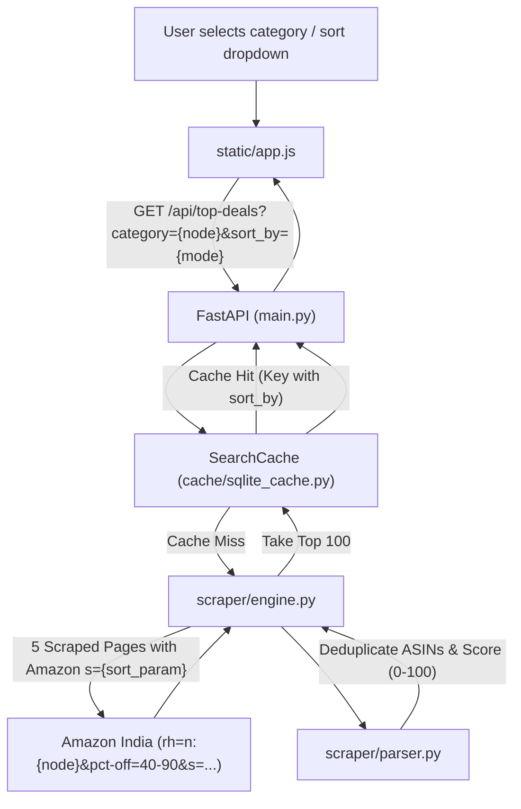

# Top 100 Popular Deals by Category — Design Spec

**Date:** 2026-10-26  
**Status:** Approved  

## Overview

Upgrade the **Top Deals** feature to harvest and display up to **100 products** per Amazon.in category (up from 50) and introduce multi-mode sorting with **Most Popular (Amazon Bestsellers)** as the default ranking, alongside Deal Score, Highest Discount, and Most Reviewed.

---

## Goals

1. **Top 100 Deals**: Expand scrape depth from 3 pages to 5 pages (`TOP_DEALS_PAGES = 5`) and return up to 100 deduplicated products (`TOP_DEALS_LIMIT = 100`).
2. **Popularity-First Sorting**: Default to Amazon's native popularity/bestseller sales rank (`s=popularity-rank`) combined with `pct-off` discount boundaries.
3. **Multi-Mode Sort Dropdown**: Enable users to dynamically switch sorting among:
   - `popularity` (Default — Amazon native popularity ranking)
   - `deal_score` (Weighted 0–100 composite deal index)
   - `discount` (Steepest percentage discount first)
   - `reviews` (Highest verified customer review count first)
4. **Independent Cache Partitioning**: Cache entries partitioned by `sort_by` in SQLite (`cache.db`) with a 30-minute TTL to keep responses fast without cache contamination.
5. **Fluid Responsive UI**: Glassmorphic sort dropdown cleanly aligned with category pills and loading skeleton states.

---

## Non-Goals

- User account-based custom sort preferences
- Infinite scroll beyond page 5
- Cross-category hybrid feeds

---

## Architecture & Data Flow



---

## Backend Changes

### 1. Configuration ([`config.py`](file:///d:/antigravity_sandbox/DealFinderAmazonPy/config.py))
- Update `TOP_DEALS_PAGES = 5` (fetches 5 pages $\approx 100\text{--}120$ raw tiles to guarantee $\ge 100$ unique items).
- Update `TOP_DEALS_LIMIT = 100` (returns top 100 products).

### 2. SQLite Cache Key ([`cache/sqlite_cache.py`](file:///d:/antigravity_sandbox/DealFinderAmazonPy/cache/sqlite_cache.py))
- Update `make_category_cache_key`:
  ```python
  def make_category_cache_key(
      node: str, min_discount: int, max_discount: int, sort_by: str = "popularity"
  ) -> str:
      raw = f"top-deals:{node}:{min_discount}:{max_discount}:{sort_by}"
      return hashlib.sha256(raw.encode()).hexdigest()
  ```

### 3. Scraper Engine ([`scraper/engine.py`](file:///d:/antigravity_sandbox/DealFinderAmazonPy/scraper/engine.py))
- Update `build_category_url` to support Amazon sort ranking:
  ```python
  def build_category_url(
      node: str, min_discount: int, max_discount: int, page: int, sort_by: str = "popularity"
  ) -> str:
      amazon_sort_map = {
          "popularity": "popularity-rank",
          "discount": "discount-percent-rank",
          "reviews": "review-rank",
          "deal_score": "discount-percent-rank",
      }
      amazon_sort = amazon_sort_map.get(sort_by, "popularity-rank")
      params = {
          "rh": f"n:{node}",
          "pct-off": f"{min_discount}-{max_discount}",
          "s": amazon_sort,
          "page": page,
      }
      return f"{config.AMAZON_BASE_URL}?{urlencode(params)}"
  ```
- Update `search_category_deals` to accept `sort_by: str = "popularity"`:
  - Cache lookup uses updated cache key.
  - Loops `1` to `config.TOP_DEALS_PAGES` (5 pages) passing `sort_by`.
  - Calculates `deal_score` and `is_true_deal` for all products.
  - Sort logic:
    - If `sort_by == "deal_score"`: Sort by `deal_score` descending.
    - If `sort_by == "discount"`: Sort by `discount_pct` descending.
    - If `sort_by == "reviews"`: Sort by `review_count` descending (None $\rightarrow$ 0).
    - If `sort_by == "popularity"`: Maintain Amazon's scraped order (already ordered by bestseller popularity).
  - Truncates to `config.TOP_DEALS_LIMIT` (100 items).

### 4. API Route ([`main.py`](file:///d:/antigravity_sandbox/DealFinderAmazonPy/main.py))
- Update `/api/top-deals`:
  ```python
  @app.get("/api/top-deals")
  async def api_top_deals(
      category: str = Query(..., min_length=1, description="Amazon browse-node ID"),
      min_discount: int = Query(40, ge=0, le=99, description="Minimum discount %"),
      max_discount: int = Query(90, ge=1, le=100, description="Maximum discount %"),
      sort_by: str = Query("popularity", pattern="^(popularity|deal_score|discount|reviews)$", description="Sort order"),
  ):
  ```
  Passes `sort_by` to `search_category_deals`.

---

## Frontend Changes

### 1. Structure ([`static/index.html`](file:///d:/antigravity_sandbox/DealFinderAmazonPy/static/index.html))
- In `#tab-top-deals`, add a toolbar container containing:
  - Existing `#category-pill-bar`.
  - Sort bar with a styled `<select id="top-deals-sort">`:
    - `<option value="popularity" selected>🔥 Most Popular</option>`
    - `<option value="deal_score">🏆 Deal Score</option>`
    - `<option value="discount">💰 Highest Discount</option>`
    - `<option value="reviews">⭐ Most Reviewed</option>`
  - Result count display badge `#top-deals-count`.

### 2. Logic ([`static/app.js`](file:///d:/antigravity_sandbox/DealFinderAmazonPy/static/app.js))
- Track `currentCategoryNode`, `currentCategoryName`, and `currentSortBy = 'popularity'`.
- Pass `sort_by` to `/api/top-deals?category=${node}&sort_by=${sortBy}`.
- Dropdown `change` event listener re-invokes `fetchCategoryDeals(currentCategoryNode, currentCategoryName, currentSortBy)`.
- Updates result count badge on successful load (`Showing X Deals`).

### 3. Styling ([`static/style.css`](file:///d:/antigravity_sandbox/DealFinderAmazonPy/static/style.css))
- Add CSS rules for `.top-deals-toolbar`, `.sort-container`, `.sort-select`, and `.deals-count-badge`.

---

## Testing Strategy

- `tests/test_category_url.py`: Verify generated Amazon URLs for all 4 sort modes.
- `tests/test_search_category_deals.py`: Verify 100 items limit, cache key formatting with `sort_by`, and post-scrape sorting behavior.
- `tests/test_top_deals_api.py`: Verify `/api/top-deals` defaults to `popularity` and handles each valid sort option, rejecting invalid sort strings with 422.
